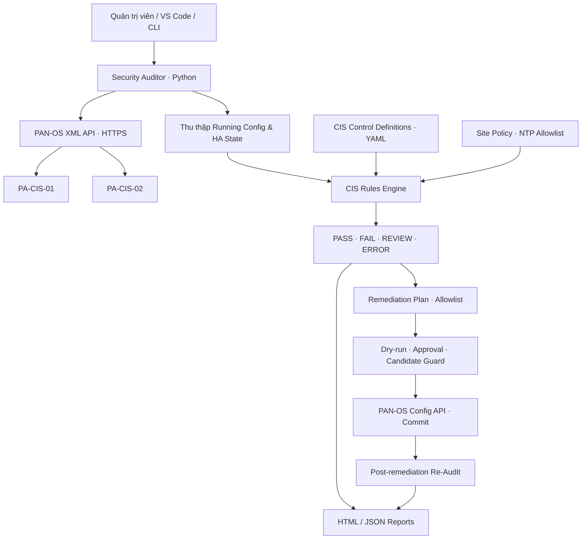

# CIS Palo Alto Security Auditor

**Hệ thống tự động đánh giá và hỗ trợ khắc phục cấu hình bảo mật tường lửa Palo Alto theo tiêu chuẩn CIS Benchmark**

> **Automated Security Configuration Assessment & Controlled Remediation for Palo Alto Firewalls**  
> Đồ án tập trung xây dựng quy trình **Audit → Phân tích tuân thủ → Remediation có kiểm soát → Re-Audit**, giúp giảm thao tác kiểm tra thủ công, chuẩn hóa bằng chứng và theo dõi sự thay đổi mức độ tuân thủ cấu hình bảo mật.

| Thông tin | Chi tiết |
|---|---|
| **Lĩnh vực** | Network Security · Security Automation · Configuration Compliance |
| **Chuẩn đánh giá** | CIS Palo Alto Firewall 11 Benchmark v1.2.0 |
| **Nền tảng kiểm thử** | Palo Alto VM-Series · PAN-OS 11.2.5 · CMC Cloud |
| **Ngôn ngữ / giao diện** | Python 3 · PAN-OS XML API · Rich CLI |
| **Đầu ra** | Báo cáo HTML, JSON; lịch sử kết quả đánh giá |
| **Trạng thái** | Prototype đang được kiểm thử trong môi trường lab, **không phải công cụ production** |

## 1. Tổng quan đề tài

Trong môi trường doanh nghiệp, tường lửa thường được triển khai với nhiều thiết lập quản trị, xác thực, dịch vụ hệ thống và High Availability (HA). Việc đối chiếu từng mục cấu hình với chuẩn bảo mật bằng phương pháp thủ công tốn thời gian, khó thực hiện lặp lại và dễ thiếu nhất quán giữa các thiết bị.

Dự án **CIS Palo Alto Security Auditor** xây dựng một hệ thống tự động thu thập thông tin cấu hình và trạng thái vận hành từ tường lửa Palo Alto, đối chiếu với các khuyến nghị được lựa chọn trong **CIS Palo Alto Firewall 11 Benchmark v1.2.0**, đồng thời hỗ trợ lập kế hoạch và thực hiện **một số thao tác khắc phục có kiểm soát**.

Mục tiêu của hệ thống không chỉ là đưa ra kết quả `PASS` hoặc `FAIL`, mà còn xác định trường hợp thiếu bằng chứng (`REVIEW`), ghi nhận nguyên nhân, tạo báo cáo có thể kiểm tra lại và hỗ trợ quy trình **Before / After** sau khi khắc phục.

## 2. Mục tiêu và đóng góp

- **Tự động hóa đánh giá cấu hình:** Thu thập *Running Configuration* qua PAN-OS XML API, kết hợp trạng thái vận hành khi tiêu chí yêu cầu.
- **Chuẩn hóa quy tắc CIS:** Phân tách dữ liệu cấu hình, logic đánh giá và metadata/chính sách trong các module Python và YAML.
- **Đánh giá dựa trên bằng chứng:** Phân biệt `PASS`, `FAIL`, `REVIEW` và `ERROR`; không tự cho `PASS` khi XML thiếu dữ liệu hoặc điều kiện chưa được kiểm chứng.
- **Hỗ trợ nhiều thiết bị:** Thực hiện đánh giá độc lập trên các firewall trong cùng phiên chạy.
- **Khắc phục có kiểm soát:** Giới hạn các control được phép thay đổi; hỗ trợ xem trước kế hoạch (*dry-run*), xác nhận rõ ràng, kiểm tra Candidate Configuration, Commit và đánh giá lại.
- **Báo cáo và truy vết:** Xuất JSON có cấu trúc và HTML trực quan; lưu thời điểm quét, giá trị thực tế, kết quả và lý do đánh giá.

## 3. Kiến trúc hệ thống



**Nguyên tắc thiết kế:** Chức năng **Audit** mặc định chỉ đọc, tách biệt với chức năng **Remediation**. Mọi thay đổi cấu hình phải được yêu cầu một cách tường minh và có bước xác nhận trước khi áp dụng.

## 4. Các chức năng chính

| Nhóm chức năng | Mô tả |
|---|---|
| **Configuration Collection** | Xác thực PAN-OS XML API, đọc Running Configuration và thông tin HA vận hành cần thiết |
| **CIS Compliance Assessment** | Đối chiếu cấu hình với điều kiện CIS, trả kết quả kèm giá trị và bằng chứng |
| **Multi-Firewall Audit** | Quét PA-CIS-01 và PA-CIS-02, báo cáo theo từng thiết bị |
| **Compliance Metrics** | Thống kê số control `PASS / FAIL / REVIEW / ERROR`, tỷ lệ đánh giá được và điểm tuân thủ trong phạm vi đã đánh giá |
| **Controlled Remediation** | Dry-run, allowlist, xác nhận người vận hành, kiểm tra thay đổi chờ và xác minh sau Commit |
| **Reporting** | Sinh báo cáo JSON/HTML có timestamp, phục vụ đối chiếu trước và sau khắc phục |
| **Offline Testing** | Bộ XML fixture và unit tests để kiểm tra logic mà không cần kết nối firewall thật |

### Phạm vi CIS Controls hiện được triển khai

| Nhóm | Control | Nội dung đánh giá |
|---|---|---|
| Management Interface | `1.2.3` | Vô hiệu hóa HTTP và Telnet trên Management Interface |
| Password Security | `1.3.1–1.3.9` | Bật Password Complexity; chiều dài, thành phần và chính sách mật khẩu |
| Authentication | `1.4.1` | Management Idle Timeout không vượt quá 10 phút |
| Device Services | `1.6.2` | NTP chính và NTP dự phòng phù hợp chính sách tổ chức |
| High Availability | `3.1` | Trạng thái HA peer, configuration/session synchronization |
| High Availability | `3.2` | Link Monitoring hoặc Path Monitoring |

Tổng cộng có **14 control được lựa chọn để triển khai**. Đây là phạm vi nghiên cứu và thử nghiệm của nhóm, **không đại diện cho toàn bộ CIS Benchmark**. Một số trường hợp cần đối chiếu thêm GUI/CLI, trạng thái vận hành hoặc chính sách tổ chức trước khi kết luận.

### Phạm vi Automated Remediation

Phiên bản hiện tại chỉ cho phép lên kế hoạch và khắc phục theo **allowlist gồm 4 control**: `1.2.3`, `1.3.1`, `1.3.2`, `1.4.1`. Các thay đổi về HA và NTP không được tự động áp dụng trong phiên bản này. Tính năng remediation yêu cầu quyền quản trị phù hợp và chưa được xác nhận đầy đủ trên mọi trường hợp vận hành thực tế.

## 5. Môi trường triển khai và kết quả thực nghiệm

Hệ thống được thử nghiệm trong môi trường **CMC Cloud**, gồm hai firewall **Palo Alto VM-Series** chạy **PAN-OS 11.2.5** và một **Linux Bastion** làm máy điều khiển. Môi trường truy cập quản trị được tổ chức qua mạng riêng và Tailscale VPN. Các IP quản trị và thông tin xác thực không được công bố trong README.

**Kết quả đã ghi nhận:**

- Chạy thành công **12/12 unit tests** với dữ liệu XML giả lập.
- Kết nối và xác thực PAN-OS XML API trên **cả hai firewall**.
- Thu thập Running Configuration và dữ liệu HA; thực hiện quét **14 control/thiết bị**.
- Tạo báo cáo **HTML và JSON** cho từng lần quét.
- Ghi nhận đúng các trường hợp `PASS`, `FAIL`, `REVIEW`; một số kiểm tra HA chưa đạt vì lab tại thời điểm đó chưa bật HA.

**Snapshot ban đầu — 18/10/2026 (trước khi hoàn thiện HA và remediation):**

| Thiết bị | PASS | FAIL | REVIEW | Đánh giá được | Compliance* |
|---|---:|---:|---:|---:|---:|
| PA-CIS-01 | 3 | 4 | 7 | 7/14 | 42,86% |
| PA-CIS-02 | 2 | 4 | 8 | 6/14 | 33,33% |

*Compliance = PASS / (PASS + FAIL). Các control `REVIEW`/`ERROR` không được tính là đạt. Đây là **đường cơ sở (baseline)** của các control đã được đánh giá, không phải mức tuân thủ tổng thể CIS Benchmark hay kết quả cuối cùng của hệ thống.*

## 6. Quy trình hoạt động

1. **Collect:** Kết nối firewall và thu thập các trường cấu hình/trạng thái cần thiết.
2. **Evaluate:** Đối chiếu từng control với ngưỡng và điều kiện từ CIS và chính sách site.
3. **Report:** Tổng hợp kết quả, nguyên nhân và xuất HTML/JSON.
4. **Plan:** Với control được hỗ trợ, xây dựng kế hoạch remediation và hiển thị thay đổi dự kiến.
5. **Apply & Verify:** Chỉ khi được người vận hành cho phép, thực hiện thay đổi có kiểm soát, Commit và quét lại để xác định kết quả sau khắc phục.

## 7. Cấu trúc repository

```text
CIS-PaloAlto-Auditor/
├── main.py                    # CLI, Rich dashboard, multi-device workflow
├── src/
│   ├── panos_client.py        # PAN-OS XML API client
│   ├── cis_scanner.py         # CIS checks & evidence handling
│   ├── remediation.py         # Controlled remediation logic
│   └── reporting.py           # JSON & HTML generation
├── rules/
│   ├── cis_controls.yaml      # Control metadata and thresholds
│   └── site_policy.yaml       # Organization-specific policy
├── templates/
│   └── report.html            # HTML report template
├── tests/                     # Pytest & synthetic XML fixtures
├── docs/                      # Architecture, deployment, demo, test plan
├── evidence/                  # Local evidence (excluded from Git)
└── reports/                   # Local scan reports (excluded from Git)
```

## 8. Tài liệu dự án

Để README tập trung vào **giới thiệu và kết quả đồ án**, phần lệnh cài đặt, cấu hình và demo được tách riêng:

- [Triển khai và vận hành](docs/DEPLOYMENT.md)
- [Kiến trúc chi tiết](docs/ARCHITECTURE.md)
- [Kịch bản demo](docs/DEMO_KICH_BAN.md)
- [Kế hoạch kiểm thử](docs/TEST_PLAN.csv)
- [Danh sách kiểm tra thủ công](docs/MANUAL_CHECKLIST.csv)

## 9. Giới hạn và định hướng phát triển

Dự án là **prototype phục vụ nghiên cứu, học tập và kiểm chứng trên lab**. Các giới hạn quan trọng gồm: mới bao phủ 14 control, một số thiết lập mặc định hoặc dữ liệu HA cần xác minh thêm, chưa có rollback tự động khi Commit thất bại và chưa kiểm thử đầy đủ mọi trạng thái PAN-OS/HA. Chương trình không thay thế quy trình change management hoặc phê duyệt thay đổi cấu hình của doanh nghiệp.

Các hướng mở rộng tiếp theo:

- Chuẩn hóa thêm CIS Controls và mở rộng hệ thống rules dạng YAML.
- Tăng bộ test dữ liệu thật đã khử thông tin nhạy cảm và kiểm tra khác biệt giữa các phiên bản PAN-OS.
- Hoàn thiện HA Active/Passive và xác minh đồng bộ, Link/Path Monitoring.
- So sánh lịch sử tuân thủ theo thời gian; bổ sung báo cáo tổng hợp nhiều thiết bị.
- Bổ sung quản lý phân quyền, ghi nhật ký hành động và quy trình phê duyệt remediation.

## 10. Tài liệu tham khảo

- **CIS Palo Alto Firewall 11 Benchmark v1.2.0** — tài liệu chuẩn sử dụng trong phạm vi nghiên cứu; không phân phối lại bản PDF Benchmark trong repository.
- [Palo Alto Networks — PAN-OS XML API](https://docs.paloaltonetworks.com/ngfw/api/pan-os-xml-api-request-types-and-actions)
- [Palo Alto Networks — XML API Commit](https://docs.paloaltonetworks.com/ngfw/api/pan-os-xml-api-request-types-and-actions/commit)
- [Palo Alto Networks — HA Synchronization](https://docs.paloaltonetworks.com/ngfw/administration/high-availability/reference-ha-synchronization)

---

**CIS Palo Alto Security Auditor** — *Automate assessment. Control remediation. Verify compliance.*
