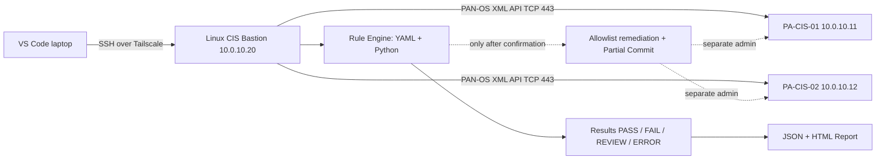
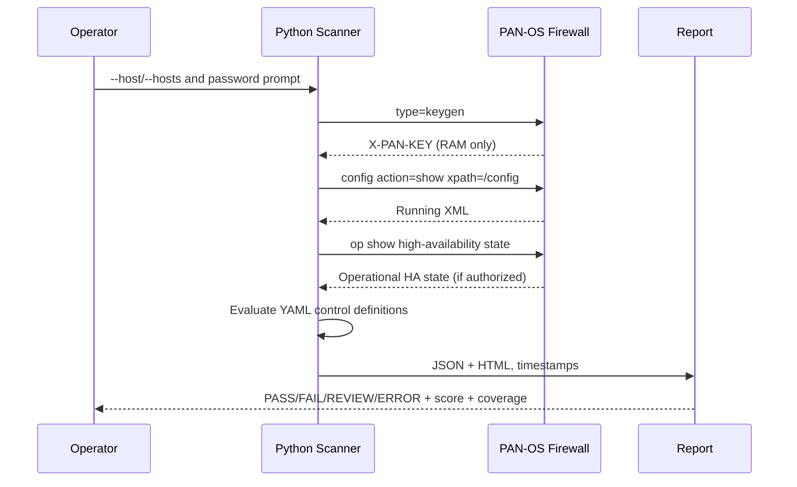

# Kiến trúc và luồng thực thi

## Thành phần



## Read-only Audit Sequence



## Controlled Remediation Sequence

```mermaid
sequenceDiagram
    participant Operator
    participant Tool as Python Remediation
    participant FW as Palo Alto XML API
    Operator->>Tool: --remediate CIS_ID
    Tool-->>Operator: Preview + dry-run (NO write)
    Operator->>Tool: --apply + host guard + ack HA
    Tool-->>Operator: Exact phrase confirmation
    Operator->>Tool: APPLY HOST CIS_ID
    Tool->>FW: config action=get (Candidate)
    FW-->>Tool: Candidate XML
    Tool->>Tool: Compare Candidate vs Running; reject pending changes
    Tool->>FW: config action=set (allowlist only)
    Tool->>FW: commit action=partial (by write admin)
    FW-->>Tool: Commit Job ID
    loop Until FIN/OK or timeout
        Tool->>FW: op show jobs id
    end
    Tool->>FW: config action=show (post-commit)
    Tool->>Tool: Re-evaluate CIS_ID
    Tool-->>Operator: before/after HTML+JSON, verify HA peer separately
```

### Tính năng và giới hạn
- Ưu tiên không thay đổi firewall trong chế độ audit; remediation default dry-run.
- Nội dung `--lab-insecure` chỉ thích hợp với lab cách ly sử dụng certificate tự ký.
- Candidate diff guard + Partial Commit riêng theo user giảm rủi ro commit nhầm nhưng không thay thế quy trình change management.
- Không tự rollback; nếu commit failed/timeout phải kiểm tra thủ công candidate và job. Không sửa HA tự động.
- Quét PA-CIS-01/02 độc lập, không suy ra PASS trên peer từ một firewall.
